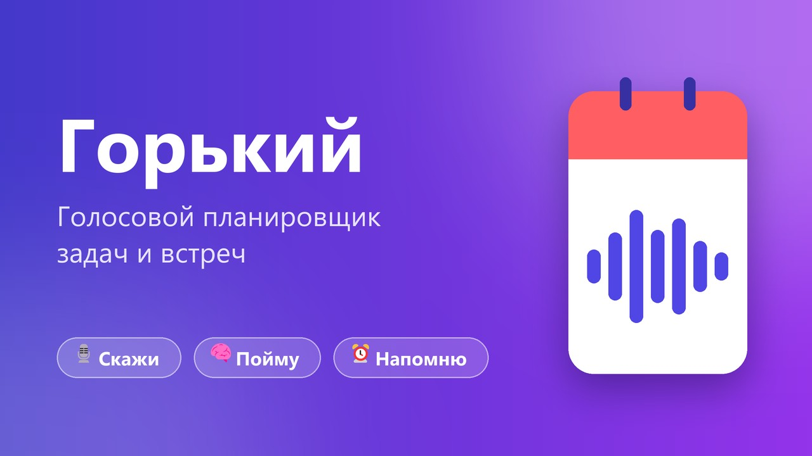
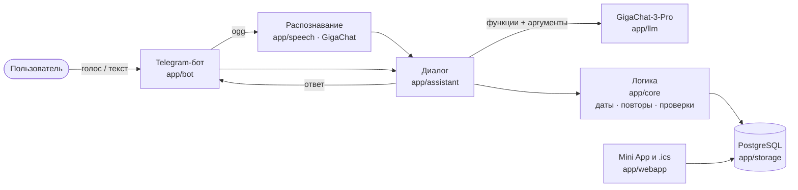

<p align="center">
  
</p>

<h1 align="center">Горький — голосовой планировщик</h1>

<p align="center">
  Telegram-бот, который по свободной речи создаёт задачи, напоминания и встречи,<br>
  показывает планы на любой период и находит старые записи по смыслу.
</p>

<p align="center">
  <a href="https://t.me/gorky_audio_bot"></a>
  
  
  
  
  
  
</p>

---

## Попробовать за минуту

1. Открыть **[@gorky_audio_bot](https://t.me/gorky_audio_bot)** и нажать «Старт».
2. В меню — **«📥 Демо-данные из задания»**: загрузит 1000 записей из CSV тестового задания.
3. Спросить голосом или текстом: *«Когда у меня была встреча с Иваном?»*, *«Что запланировано на эту неделю?»*,
   *«Напомни завтра в 10 позвонить маме»*.

## Возможности

| Сценарий | Как сказать |
|---|---|
| ⏰ Задача или напоминание | «Напомни завтра в 10 утра позвонить Ивану», «В пятницу нужно отправить отчёт» |
| 🤝 Встреча | «В четверг в 11 у меня встреча с дизайнером» — предупредит о пересечениях |
| 📅 Планы за период | «Что у меня сегодня?», «Какие задачи на завтра?», «Что запланировано на неделю?» |
| 🔎 Поиск по смыслу | «Найди задачу про презентацию», «Я когда-то ставил задачу по договору» |
| 💬 Уточнения | «Поставь встречу с Иваном завтра» → «На какое время поставить встречу?» |
| ✏️ Изменения | «Перенеси её на пятницу», «Переименуй в …», «Я купил билеты», «Встреча отменилась» |
| 🔁 Повторы | «Каждый понедельник в 10 планёрка», «Напоминай каждый день в 22:00» |
| ⚙️ Настройки | «Я в Новосибирске», «Присылай план по утрам в 8», «Напоминай о встречах за 30 минут» |

**Ещё:** напоминания приходят сами (кнопки «+10 мин / +1 час / Готово»), утренняя сводка, голосовые ответы,
«Вернуть» после удаления, единая панель-меню без мусора в чате, Mini App-календарь внутри Telegram
и подписка на календарь телефона (iPhone / Google) в одно нажатие.

## Как это работает



**Главный принцип:** модель не пишет в базу сама. Она выбирает функцию — `create_event`, `list_events`,
`search_events`, `update_event`, `complete_event`, `delete_event`, `update_settings` — и заполняет аргументы,
а код проверяет их и выполняет действие. Если данных не хватает, бот задаёт уточняющий вопрос.

| Слой | Модуль | Ответственность |
|---|---|---|
| Интерфейс | `app/bot/` | панель-меню, кнопки, голосовые, напоминания и утренняя сводка |
| Голос | `app/speech/` | распознавание — GigaChat (аудио), озвучка — edge-tts |
| Диалог | `app/assistant/` | история и контекст («перенеси **её**»), уточнения, выполнение действий |
| LLM | `app/llm/` | интерфейс `LLMClient` + GigaChat, описания функций |
| Логика | `app/core/` | относительные даты, повторы, оформление ответов, iCalendar |
| Данные | `app/storage/` | SQLAlchemy 2 (async), Alembic, полнотекстовый поиск |
| Поиск | `app/search/` | если полнотекстовый поиск пуст — GigaChat выбирает подходящие записи |
| Веб | `app/webapp/` | Mini App-календарь, подписка на календарь, проверка подписи Telegram |

## Решения

- **Telegram вместо веб-страницы.** Голосовые «из коробки», ссылка на бота — это и есть рабочий прототип,
  каждый пользователь Telegram получает свои данные.
- **GigaChat-3-Pro.** Сильный русский язык, вызов функций и распознавание речи — одним ключом.
  Модель выбрана по замерам на наборе фраз из ТЗ (`scripts/eval_phrases.py`).
- **Даты считает код, а не модель.** Модель возвращает «завтра», «в четверг», «через 2 часа», «до конца недели»,
  а точную дату вычисляет `app/core/dates.py` — так исчезли ошибки вида «четверг → суббота».
- **Поиск по смыслу без платных эмбеддингов.** Полнотекстовый поиск Postgres с русской морфологией
  («договору» → «договор»): сначала записи со всеми словами, ближайшие к сегодня; «когда **была**» ищет
  в прошлом. Если ничего не найдено — GigaChat выбирает из последних записей («Ваня» → «Встреча с Иваном»).
- **PostgreSQL.** Данные переживают перезапуски и деплой.
- **Озвучка edge-tts.** SaluteSpeech для физлиц закрыт с 15.07.2026; если озвучка недоступна, бот отвечает текстом.

## Качество

- **57 автотестов** (`pytest`) — даты, повторы, действия, поиск, клавиатуры, веб-API; LLM замокан.
- **Проверочный набор фраз** на живом GigaChat — **35 из 37**: создание, списки, изменения по контексту,
  настройки и поиск по смыслу.

## Запуск локально

Нужны Python 3.12+, PostgreSQL 16, токен бота от [@BotFather](https://t.me/BotFather) и ключ GigaChat API.

```bash
python -m venv .venv && .venv/Scripts/pip install -r requirements-dev.txt   # Linux/macOS: .venv/bin/
cp .env.example .env            # BOT_TOKEN, GIGACHAT_CREDENTIALS, DATABASE_URL
alembic upgrade head            # таблицы
python -m app.main              # бот + Mini App на :8080
pytest -q                       # тесты
python -m scripts.eval_phrases  # проверочные фразы на живом GigaChat
```

## Деплой

```bash
git clone https://github.com/NIZHEGORODTSY/GORKY_CODE.git && cd GORKY_CODE
# положить .env с прод-настройками (POSTGRES_*, BOT_TOKEN, GIGACHAT_CREDENTIALS, DATABASE_URL с хостом db)
./scripts/deploy.sh             # git pull + docker compose: PostgreSQL 16 + бот; миграции — при старте
```

- **HTTPS для Mini App и подписки на календарь** — `WEBAPP_DOMAIN=<домен>`. Порты 80/443 свободны → поднимется
  Caddy с Let's Encrypt; на сервере уже есть nginx → `REVERSE_PROXY=nginx`, `deploy/nginx-gorky.conf`
  и `certbot --nginx -d <домен>`.
- **Хостинг блокирует Telegram** — `python3 scripts/vless_to_xray.py '<VPN-подписка>'` и
  `TELEGRAM_PROXY=socks5://xray:1080`: через прокси идёт только Telegram, GigaChat и база — напрямую.
- **База с компьютера** — `ssh -N -L 5433:127.0.0.1:5433 root@<сервер>` и pgAdmin на `localhost:5433`.

## Структура

```
app/
  bot/         Telegram: панель, кнопки, голос, напоминания, сводка
  assistant/   диалог и выполнение действий
  llm/         GigaChat и описания функций
  speech/      распознавание и озвучка
  core/        даты, повторы, оформление, iCalendar, демо-данные
  storage/     таблицы и запросы к базе
  search/      поиск по смыслу через GigaChat
  webapp/      Mini App, подписка на календарь
migrations/    Alembic
tests/         pytest
scripts/       деплой, проверка фраз, прокси для Telegram
assets/        баннер, аватар, CSV из тестового задания
```

## Что улучшили бы

- Эмбеддинги (локальная модель или платный API) для поиска по смыслу на тысячах записей.
- Прямая интеграция с Google Calendar API — мгновенная синхронизация вместо подписки.
- Хранение истории диалога в базе — сейчас она живёт в памяти процесса.
- Проверочный набор фраз в CI, чтобы видеть качество понимания на каждом изменении.
